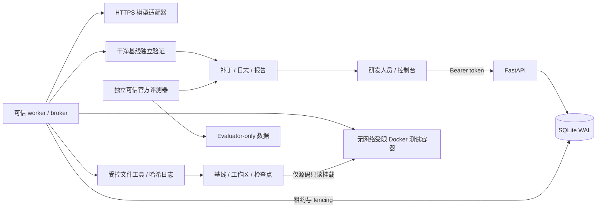
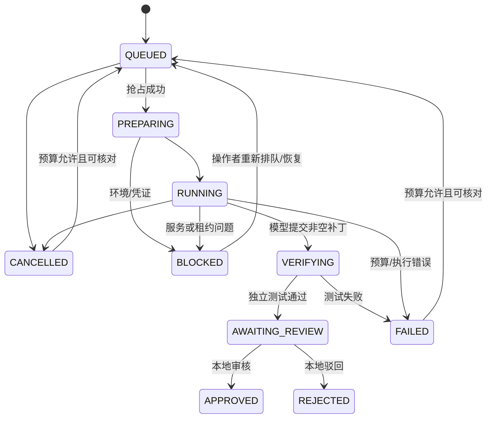

# 架构与设计决策

## 状态机

具体允许边以 `harness/store.py:TRANSITIONS` 为准。`APPROVED` 是本地审核终态；平台没有 `MERGED` 或 `PUBLISHED` 接入。

## 数据模型

`tasks` 保存来源、运行规范、状态、累计预算、所有者、租约、fence、取消标志、实验组与可空官方判定。`attempts` 记录每次 worker 抢占。`events` 使用数据库递增序号与时间记录动作及结果。`operations` 保存文件路径、前后哈希、内容与 PENDING/CONFIRMED/NOT_APPLIED。`checkpoints` 保存完整文件清单、上下文、已消耗预算与环境标识。`artifacts` 指向受哈希保护的本地产物。`reviews` 单独保存人工意见。`experiments` 固定样本与配置。迁移位于 `harness/migrations/001.sql`，首次启动幂等执行；此版本仅有 v1，后续变更必须新增迁移，不能覆盖已有生产模式。

## 恢复协议

1. `BEGIN IMMEDIATE` 串行抢占并递增 fence。仅一个任务持有效执行租约；watchdog 在准备、模型与工具阶段续租并累计运行时长。
2. 文件动作先提交 PENDING 意图；实际替换与确认在再次核对 fence 后，持数据库写锁执行。使用同目录临时文件、fsync、os.replace；模型不能选绝对宿主路径。
3. 如果在文件替换后确认前进程退出，PENDING 日志仍在。新 worker 先停止该任务的遗留容器，再比较文件与 before/after 哈希：after 则确认；before 则标为未应用；两者皆非则阻止自动恢复。
4. 检查点记录代码基线、完整 manifest、摘要、预算、环境和最后持久化事件。完整快照保留最近两份，其余保留审计元数据。恢复校验快照哈希，保留检查点后的已确认写入；无法解释的工作区变化先归档，再恢复最近可信快照。
5. 模型调用、token 预留、工具时长和累计工作时长不会因重试或恢复清零。已确认写入不会因数据库 step 编号而盲目重放。

崩溃测试真实使用独立 Python 进程，在 `os.replace` 后 `os._exit(91)`，随后过期租约、抢占、核对、恢复；没有通过抛出普通异常来替代进程死亡。

恢复不覆盖内存进程、任意外部副作用或逐字模型重放。模型 HTTP 请求结果不确定时保留调用预留；测试过程的可写文件在受限 tmpfs 内，调用结束即丢弃。未知副作用需要人工核对。SQLite 与文件替换依赖可靠本地文件系统；不支持把 WAL 数据库放到 NFS 或多宿主共享盘。

## 执行与验证

源码通过固定 GitHub owner/repo + 40 位 commit 的 ZIP 下载，限制传输及解压大小、文件数量，拒绝 symlink/junction 和越界。不克隆后续历史，不读取 `.git`，宿主不运行仓库 hooks、setup 或 Python 模块。

模型只能发出结构化工具请求。文件检索为可解释的字面匹配；上下文超限时保留 issue、约束和最近动作证据，完整事件留在时间线。当前为提取式摘要，不包含语义索引或第二模型。

Agent 的探索测试与干净目录验证分别标记。最终验证重新复制原始 baseline，仅携带通过策略检查的源文件修改；原始 tests/conftest/构建测试配置不能被模型修改。固定 `/opt/venv/bin/python -m pytest` 运行，禁止任意命令和插件参数。不同仓库需要操作者准备依赖镜像与测试选择器，尚未实现自动 SWE-bench 镜像适配。

官方 SWE-bench 通过 `scripts/official_eval.py` 的独立可信环境执行。每次 run ID 含 UUID 与补丁哈希，工作目录隔离，避免旧 run 缓存误命中。仅从此次 run 的官方 instance report 导入 resolved。用户下载的报告不能通过 API 直接写入官方评分。

## 取舍与边界

- SQLite + 单 worker 降低部署成本；不支持横向多机，事务占用和快照复制是主要瓶颈。
- 原生 JS + 同源 API，无 Node 构建依赖；保持可读日志、差异和真实状态，避免图表制造不存在的结果。
- 全量快照优先可靠性，保留两份完整快照；未实现内容寻址去重。单源码目录上限默认256MiB，每任务含基线/快照需要更多空间。
- 供应商模型版本以返回字段为准；无法返回时记 unavailable。token 实际值与保守预算预留分列；没有价格来源时不计算费用。
- 依赖锁精确固定 Python 包版本，但镜像构建需要上线操作者固定基础镜像 digest，评测包还需在目标 Linux 环境生成并验证完整传递依赖锁。
